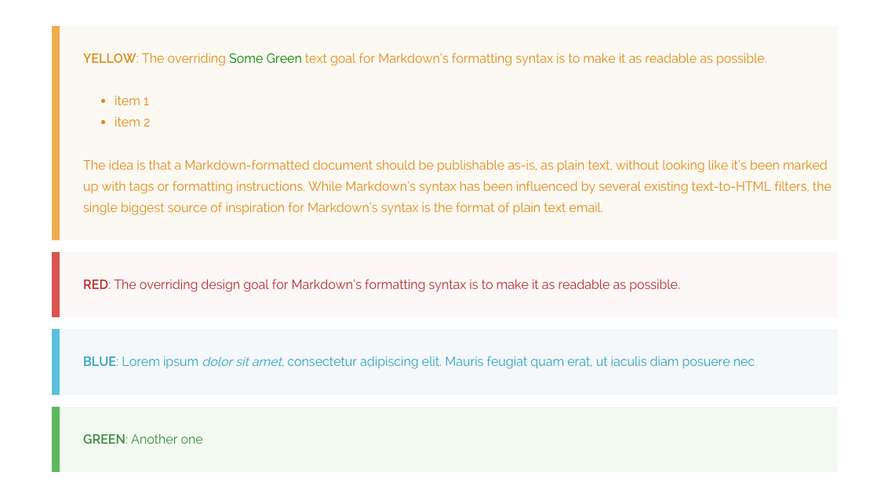

# Grav Markdown Notices Plugin

The **markdown-notices plugin** for [Grav](http://github.com/getgrav/grav) allows generation of notice blocks of text via markdown:



# Installation

This plugin is easy to install with GPM.

```
$ bin/gpm install markdown-notices
```

# Configuration

Simply copy the `user/plugins/markdown-notices/markdown-notices.yaml` into `user/config/plugins/markdown-notices.yaml` and make your modifications.

```
enabled: true
built_in_css: true
base_classes: 'notices'
level_classes: [yellow, red, blue, green]
```

| Option | Default | Description |
|---|---|---|
| `enabled` | `true` | Enables the plugin. |
| `built_in_css` | `true` | Loads the plugin stylesheet, including light and dark notice colors. Set to `false` if you want to style notices entirely from your theme. |
| `base_classes` | `notices` | Classes added to every notice block, before the level class. |
| `level_classes` | `[yellow, red, blue, green]` | Class used for each notice depth (`!`, `!!`, `!!!`, `!!!!`). |

# Examples

Using one level of `!`

```
! Lorem ipsum dolor sit amet, consectetur adipiscing elit. Mauris feugiat quam erat, ut iaculis diam posuere nec.
! Vestibulum eu condimentum urna. Vestibulum feugiat odio ut sodales porta. Donec sit amet ante mi. Donec lobortis
! orci dolor. Donec tristique volutpat ultricies. Nullam tempus, enim sit amet fringilla facilisis, ipsum ex
! tincidunt ipsum, vel placerat sem sem vitae risus. Aenean posuere sed purus nec pretium.
```

You will output the following HTML

```
<div class="notices yellow">
    <p>
        Lorem ipsum dolor sit amet, consectetur adipiscing elit. Mauris feugiat quam erat, ut iaculis diam posuere nec.
        Vestibulum eu condimentum urna. Vestibulum feugiat odio ut sodales porta. Donec sit amet ante mi. Donec lobortis
        orci dolor. Donec tristique volutpat ultricies. Nullam tempus, enim sit amet fringilla facilisis, ipsum ex
        tincidunt ipsum, vel placerat sem sem vitae risus. Aenean posuere sed purus nec pretium.
    </p>
</div>
```

The `notices` class determined by the `base_classes` and `yellow` class is determined by the `level_classes` in the configuration. You can customize this as you need.

```
!! Lorem ipsum dolor sit amet, **consectetur adipiscing** elit. Mauris feugiat quam erat, ut iaculis diam posuere nec.
!!
!! * List item a
!! * List item b
!!
!! orci dolor. Donec tristique volutpat ultricies. Nullam tempus, enim sit amet fringilla facilisis, ipsum ex
!! tincidunt ipsum, vel placerat sem sem vitae risus. Aenean posuere sed purus nec pretium.
```

Two levels of `!!` will use the second level class etc.  You can also use complex markdown inside the notices.

# Styling and dark theme

When `built_in_css` is enabled, the plugin loads `assets/notices.css`. Light-mode colors are unchanged from previous versions.

Dark-mode colors are applied automatically when the active theme marks the page as dark. The stylesheet follows official Grav conventions used by [Quark2](https://github.com/getgrav/grav-theme-quark2):

- `:root[data-theme="dark"]`
- `html.dark`
- `[data-theme="dark"]` on `html` or `body`
- `.dark` / `.dark-mode` (community themes)

If the page has not explicitly set `data-theme="light"`, the stylesheet also respects `prefers-color-scheme: dark`. Always-light sites therefore keep the original notice colors.

Each notice level uses CSS variables so a theme can retint without replacing the whole file:

```css
.notices.yellow {
    --notice-border: #f0ad4e;
    --notice-bg: #fcf8f2;
    --notice-color: #df8a13;
}

:root[data-theme="dark"] .notices.yellow {
    --notice-bg: #2b2318;
    --notice-color: #f0c36d;
}
```

To use your own styles instead, set `built_in_css: false` and target `.notices` plus your `level_classes` from the theme (for example `css/custom.css`). If you change `level_classes` away from `yellow`, `red`, `blue`, and `green`, add matching rules or variables for those class names.
